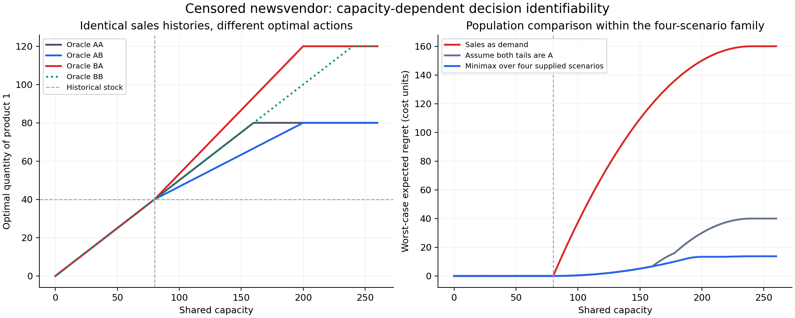

# Capacity-Aware Censored Newsvendor

Research code for **decision identifiability under censored demand and shared capacity**.

Historical sales reveal `min(demand, stock)`, not necessarily demand. This project
asks when a resource constraint makes the optimal allocation identifiable even
though the unobserved demand tails remain unknown.

**Status:** initial mathematical formulation and reproducible population example.
The example and its optimality conditions are elementary starting points; no
claim of a new publishable result is made. General identification conditions,
full ambiguity-set optimization, and finite-sample guarantees remain open tasks.

## Initial example

Two marginal demand models are observationally indistinguishable when historical
stock is 40:

- A: uniform demand on `[0, 100]`.
- B: a mixture of `0.4 × Uniform(0, 40)` and `0.6 × Uniform(40, 160)`.

Both have CDF `F(x) = x / 100` below 40 and censored sales with an atom of mass
0.6 at 40. Two products yield four latent scenarios: AA, AB, BA, BB.
Underage costs are 4, overage costs are 1, and the resource weights are 1.

| Total capacity | Oracle allocation under AB | Oracle allocation under BA |
| ---: | ---: | ---: |
| 60 | (30, 30) | (30, 30) |
| 80 | (40, 40) | (40, 40) |
| 120 | (53.333333, 66.666667) | (66.666667, 53.333333) |

The [mathematical note](docs/formulation.md) proves that the optimal action is
identified from this population sales law exactly when capacity is at most 80,
within the stated class of nonnegative finite-mean demand distributions.
The numerical example is a check of that argument, not its proof.



The committed [reference results](results/toy/summary.md) cover 131 capacities
from 0 to 260. At capacity 120 the finite-scenario minimax reference has worst
regret `5/3`, while sales-as-demand has worst regret 70 over the four supplied
worlds. The fixed A-tail policy also attains `5/3` there; this single instance
does not distinguish those two policies. Information assumptions are listed below.

## Reproduce

Python 3.11 or later is required; the initial run uses Python 3.12.

```bash
python -m venv .venv
source .venv/bin/activate
python -m pip install -r requirements.txt
python -m pip install --no-deps -e .
python -m unittest discover -s tests -v
python -m censored_newsvendor.experiment --output results/toy
```

On Windows, activate with `.venv\Scripts\activate` instead. For a quick run:

```bash
python -m censored_newsvendor.experiment --max-capacity 120 --step 20 --no-plot --output results/local/quick
```

The experiment writes all outcomes to CSV, a JSON manifest with parameters,
dependency versions and source hashes, a Markdown summary, and a figure.
No external dataset, GPU, API key, or random seed is needed for this deterministic
population experiment. `requirements.txt` pins direct dependencies; it is not a
complete transitive environment lock.

## Methods and information available

| Method | Information supplied | Role |
| --- | --- | --- |
| Oracle | True demand marginals | Unattainable reference for regret |
| Sales as demand | Exact censored sales law | Naive population baseline |
| Assume A tail | A imposed for both products | Sensitivity to a fixed tail assumption |
| Finite-scenario minimax regret | The four complete scenarios AA/AB/BA/BB | Reference under an explicitly supplied finite family |

The finite-scenario method has additional tail information. Its advantage over
sales-as-demand is **not evidence of a learned method outperforming a baseline
under equal information**. It does not optimize over every tail compatible with
censored sales. All methods are evaluated on true population expected loss, and
each scenario's oracle obeys the same capacity constraint.

The oracle solver finds the common resource multiplier and applies the adjusted
quantiles. The finite-scenario reference solves a convex epigraph problem.
Tests compare analytical losses with independent numerical integration, check
closed-form allocations, and compare solvers with independent optimization/grid
references. These checks validate this implementation within its supported scope.

## Research documents

- [Formulation, elementary certificate, and exact toy threshold](docs/formulation.md)
- [Closest literature and unresolved overlap](docs/literature.md)
- [Claim register](docs/claims.md)
- [Research protocol and failure controls](docs/research_protocol.md)
- [Next milestones](docs/roadmap.md)
- [Bibliography](references.bib)

The initial scope is a single-period, separable expected-loss problem. Demand
substitution, lead times, inventory carry-over, contextual forecasting, and time
dependence are not represented in the current implementation. Independence across
products is not needed for the separable expected-cost objective; the example can
use independent products to construct identical joint observation laws.
